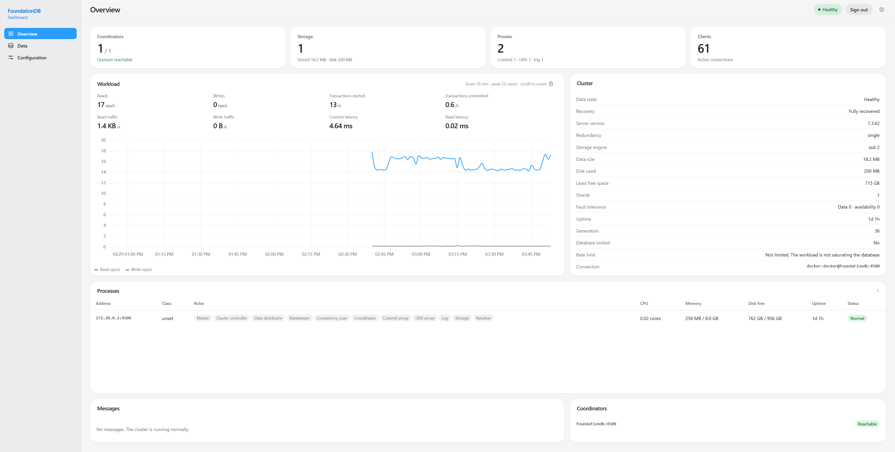
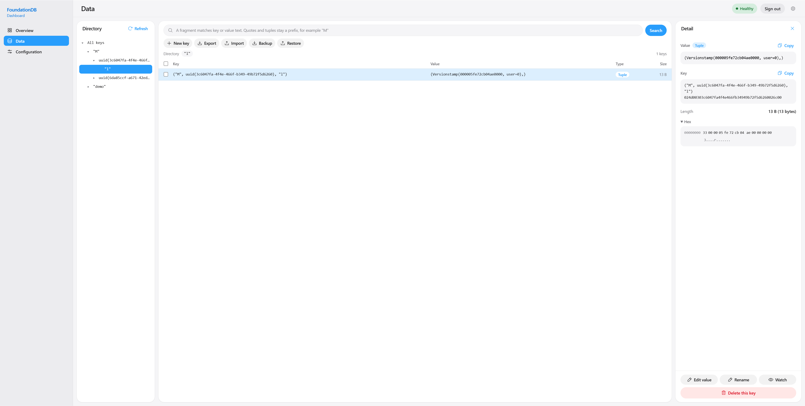
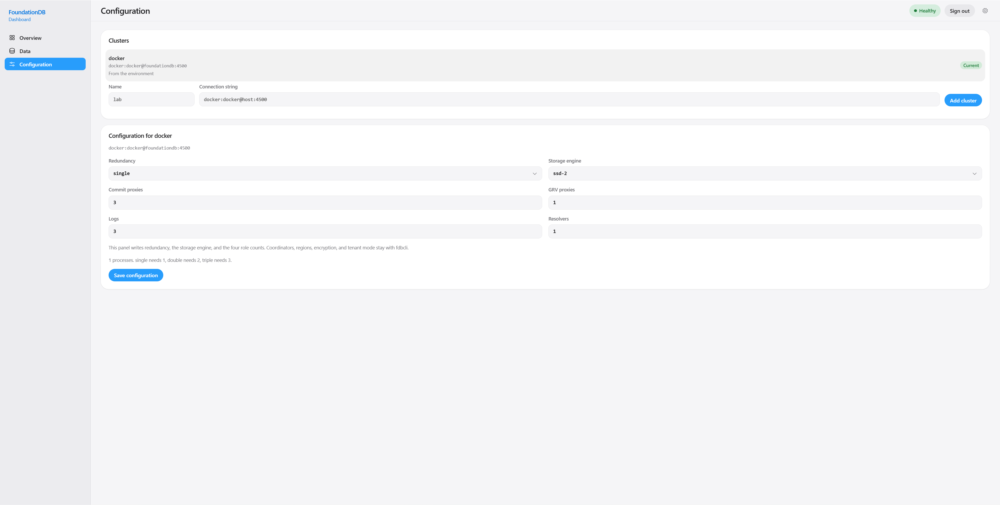

# FoundationDB Dashboard

[English](README.md) | [简体中文](README.zh-CN.md) | **繁體中文** | [Русский](README.ru.md) | [日本語](README.ja.md) | [Deutsch](README.de.md) | [Français](README.fr.md)

非官方的 FoundationDB 叢集網頁主控台。單一 Docker 映像包含頁面與 FoundationDB **7.3.62** 用戶端，資料庫在映像之外。

FoundationDB：[github.com/apple/foundationdb](https://github.com/apple/foundationdb)  
映像：[hub.docker.com/r/runu/foundationdb-dashboard](https://hub.docker.com/r/runu/foundationdb-dashboard)

## 快速開始

```bash
docker run --rm \
  -p 127.0.0.1:8090:8080 \
  --network local-foundationdb_default \
  -e FDB_CONNECTION_STRING=docker:docker@foundationdb:4500 \
  runu/foundationdb-dashboard:7.3.62
```

本機已有 Compose 叢集時：

```bash
docker compose up -d
```

開啟 [http://127.0.0.1:8090/](http://127.0.0.1:8090/)。

請將連接埠只發佈到本機 `127.0.0.1`。行程監聽 `PORT`（預設 `8080`）。

## 設定

| 變數 | 是否必要 | 說明 |
| --- | --- | --- |
| `FDB_CONNECTION_STRING` | 二選一 | 連線字串，例如 `docker:docker@foundationdb:4500` |
| `FDB_CLUSTER_FILE` | 二選一 | 容器內叢集檔路徑；兩者都設時優先使用檔案 |
| `PORT` | 否 | 容器內監聽連接埠（預設 `8080`） |
| `TREND_FILE` | 否 | 24 小時讀寫趨勢緩衝路徑 |
| `CLUSTERS_FILE` | 否 | 多叢集目錄儲存路徑 |
| `AUTH` | 否 | `on` / `off`（預設關閉）。開啟時必須設定使用者名稱與密碼 |
| `AUTH_USER` | 開啟認證時 | 登入使用者名稱（最長 64） |
| `AUTH_PASSWORD` | 開啟認證時 | 登入密碼（最長 256） |

開啟登入範例：

```bash
docker run --rm \
  -p 127.0.0.1:8090:8080 \
  --network local-foundationdb_default \
  -e FDB_CONNECTION_STRING=docker:docker@foundationdb:4500 \
  -e AUTH=on \
  -e AUTH_USER=admin \
  -e AUTH_PASSWORD=secret \
  runu/foundationdb-dashboard:7.3.62
```

## 頁面

### 概覽



叢集是否可用、資料狀態、復原狀態、冗餘模式、儲存引擎、協調者、行程與角色、讀寫負載、延遲、可容忍故障數。資料來自 `\xff\xff/status/json`，分頁可見時約每 3 秒刷新。圖表由背景每 5 秒取樣，保留約 24 小時。

### 資料瀏覽



左側目錄樹，中間為鍵表（鍵、值預覽、類型、大小），右側為詳情。列表向下捲動會繼續載入。

搜尋框可直接寫 tuple，不必只用十六進位：

```text
"M"
("M", uuid(3c6047fa-4f4e-466f-b349-49b72f5d6260), "l")
```

支援字串、整數、小數、`true` / `false` / `null`、`0x` 位元組、`uuid(...)`、`float32(...)`、`Versionstamp(...)` 與巢狀 tuple。寫前綴則列出該前綴下的鍵；不寫則列出使用者鍵空間。

值依 JSON、可讀文字、tuple、二進位辨識。4 位元組與 8 位元組小端整數會附說明。完整內容與可摺疊十六進位在詳情中。

寫入能力：

- 新建、修改、重新命名精確鍵
- 刪除單一鍵或勾選多個精確鍵（需確認；伺服器要求 `confirm: true`）
- 匯入 / 匯出、備份 / 還原
- 監看某個鍵，值變更時刷新

不提供範圍刪除。

### 叢集設定



管理已儲存的連線（新增、切換、移除）。環境內建連線不可移除。切換叢集會清空趨勢緩衝。

對**目前已連線**的叢集，可改冗餘模式、儲存引擎，以及提交代理、GRV 代理、日誌、衝突偵測四類角色數量。協調者、區域、加密與租戶模式仍用 `fdbcli`。

## 建置與測試

```bash
make test
```

此命令執行不依賴 `libfdb_c` 的套件。Docker 映像建置會執行 `go test ./...`，包含 `internal/fdbstore`（linux + cgo）。

```bash
make build
make up
```

應用程式版本於映像建置時寫入（`APP_VERSION`，預設 `1.0.0`）。

## 授權

本專案採用 [MIT License](LICENSE)。

本專案是非官方的 FoundationDB 用戶端介面。FoundationDB 本身請遵循 Apple 的授權。
